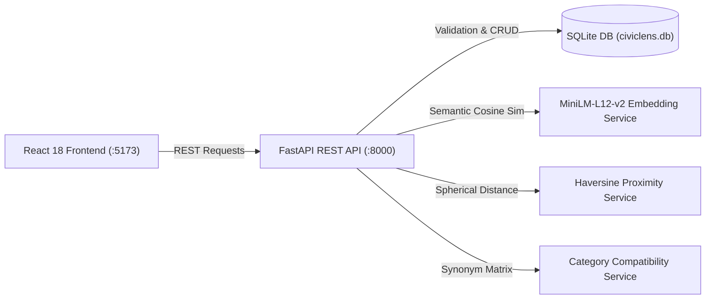

# CivicLens AI

> **"One issue. Many reports. One smarter solution."**

An Open-Source AI-Powered Civic Complaint Intelligence System built for **Hacktoberfest 2026 × GDG Cloud Rajkot** (Target Category: *Best Open-Source AI Project*).

[](https://opensource.org/licenses/MIT)
[-blue.svg)](https://huggingface.co/sentence-transformers/paraphrase-multilingual-MiniLM-L12-v2)
[](https://www.python.org/)
[](https://react.dev/)
[-success.svg)](backend/tests/)

---

## 1. Problem Statement

Municipalities face severe operational bottlenecks when citizens report civic issues such as potholes, overflowing garbage bins, water pipeline bursts, broken streetlights, and drainage overflows:

* **Multilingual Linguistic Diversity**: Multiple citizens report the identical incident using different vocabulary, descriptions, and languages (English, Hindi, Gujarati).
* **Administrative Redundancy**: Municipal call centers and portals log duplicate tickets independently, dispatching multiple field teams to the same physical site.
* **Lack of Grouped Intelligence**: Recurring severe incidents are scattered across separate database rows, masking the true severity of localized civic infrastructure failures.

## 2. Solution Overview

**CivicLens AI** is an open-source, full-stack civic intelligence platform that continuously analyzes incoming citizen complaints and correlates them against existing reports using **multi-factor mathematical triangulation**:

1. **Multilingual Semantic Embeddings (60% weight)**: Converts complaint descriptions into 384-dimensional dense vectors using the open-weight transformer `sentence-transformers/paraphrase-multilingual-MiniLM-L12-v2`.
2. **Spatial Haversine Proximity with Gaussian Decay (30% weight)**: Calculates spherical distance in meters with category-adaptive spatial decay tolerances.
3. **Civic Category Compatibility (10% weight)**: Evaluates domain synonymy (e.g. *Road Damage* $\leftrightarrow$ *Pothole* = 0.95; *Water Leakage* $\leftrightarrow$ *Drainage* = 0.85).

**Human-in-the-Loop Guarantee**: Every original complaint is permanently preserved. CivicLens AI never deletes or silently rejects citizen reports; it presents ranked duplicate candidates with transparent, human-readable audit reasons for authorized municipal review.

---

## 3. Key Features

* **Citizen Report Submission**: Public interface supporting English, Hindi (हिन्दी), and Gujarati (ગુજરાતી) with real-time duplicate pre-screening.
* **Persistent SQLite Storage**: Structured SQLAlchemy models with unique public references (`CVL-2026-0001`), coordinate validation, and cached embedding vectors.
* **Explainable AI Matching**: Component breakdown displaying Text Similarity %, Distance in meters, Category Compatibility %, and natural-language audit reasons.
* **Reviewer Incident Desk**: Protected administrative desk to confirm duplicates and cluster them into unified **Incident Groups**.
* **Live GIS Incident Map**: Interactive Leaflet map displaying complaint markers, status indicators, and category-filtered pins across the Rajkot Smart City test area.
* **Executive Civic Dashboard**: Recharts-powered analytics displaying category distribution, daily intake trends, and live system health.
* **CSV Export**: One-click administrative export for municipal GIS and work-order management.
* **Reproducible Seed & Evaluation**: Built-in 32-record synthetic dataset and automated precision/recall evaluation script.

---

## 4. UI Screenshots

| View | Preview Placeholder |
| :--- | :--- |
| **Civic Dashboard** | `[Screenshot Placeholder: Dashboard with Recharts category charts and live metrics]` |
| **Duplicate Review Desk** | `[Screenshot Placeholder: Side-by-side complaint comparison with ScoreBreakdown]` |
| **Geospatial Map** | `[Screenshot Placeholder: Leaflet map showing Rajkot complaint clusters]` |
| **Complaint Submission** | `[Screenshot Placeholder: Submission form with location presets]` |

---

## 5. Technology Stack

### Frontend
* **React 18** & **TypeScript** with **Vite** bundler
* **Tailwind CSS** (Navy & Teal civic palette)
* **React Router v6** (7 dedicated pages)
* **React Leaflet** & **Leaflet** (GIS mapping with custom SVG pins)
* **Recharts** (Category bar charts and intake trend lines)
* **Lucide React** (Consistent iconography)

### Backend
* **Python 3.11+**
* **FastAPI** & **Uvicorn** (High-performance async REST API)
* **Pydantic v2** (Strict schema validation and data sanitization)
* **SQLAlchemy 2.0** & **SQLite** (Persistent storage with JSON vector caching)
* **Sentence Transformers** (Open-weight multilingual neural embeddings)
* **Pytest** / Python built-in `unittest` runner
* **HTTPX** (API integration tests)

---

## 6. Open-Weight AI Model & Licence

| Property | Details |
| :--- | :--- |
| **Model Name** | `sentence-transformers/paraphrase-multilingual-MiniLM-L12-v2` |
| **Licence** | **Apache 2.0** (Permissive open-source licence) |
| **HuggingFace Card** | [sentence-transformers/paraphrase-multilingual-MiniLM-L12-v2](https://huggingface.co/sentence-transformers/paraphrase-multilingual-MiniLM-L12-v2) |
| **Embedding Dimension**| 384 dimensions (float32) |
| **Languages** | 50+ languages (inc. English, Hindi, Gujarati, Marathi, Tamil) |
| **Cost / Dependencies**| **$0.00** — 100% free, local, open-weight; zero paid external AI API keys |

---

## 7. Architecture



---

## 8. Quick Setup & Installation

### Prerequisites
* **Python 3.11+** installed
* **Node.js LTS (v18+)** and **npm** installed
* **Git** installed

---

### Step 1: Clone Repository

```bash
git clone https://github.com/your-username/civiclens-ai.git
cd civiclens-ai
```

---

### Step 2: Backend Setup

#### Windows PowerShell:
```powershell
cd backend
python -m venv venv
.\venv\Scripts\Activate.ps1

# Install dependencies
pip install -r requirements.txt

# Copy environment file
Copy-Item .env.example .env

# Seed 32 synthetic demo complaints (Rajkot Test Grid)
python scripts/seed_demo.py

# Start FastAPI backend server
uvicorn app.main:app --host 127.0.0.1 --port 8000 --reload
```

#### macOS / Linux:
```bash
cd backend
python3 -m venv venv
source venv/bin/activate

# Install dependencies
pip install -r requirements.txt

# Copy environment file
cp .env.example .env

# Seed 32 synthetic demo complaints
python scripts/seed_demo.py

# Start FastAPI backend server
uvicorn app.main:app --host 127.0.0.1 --port 8000 --reload
```

Backend will be running at: **`http://localhost:8000`**
Interactive Swagger API Docs: **`http://localhost:8000/docs`**

---

### Step 3: Frontend Setup

Open a separate terminal:

```bash
cd frontend

# Install Node dependencies
npm install

# Start Vite development server
npm run dev
```

Frontend will be running at: **`http://localhost:5173`**

---

## 9. Running Automated Tests

### Backend Test Suite (24 Unit & Integration Tests)
The backend test suite covers coordinate validation, Haversine distances, smooth Gaussian decay, category compatibility, API authorization guards, and duplicate review workflows:

```bash
cd backend
python -m unittest discover tests
```

Output:
```
Ran 24 tests in 0.214s
OK (All tests passing)
```

### Reproducible AI Evaluation Benchmark
Run the duplicate detection precision/recall evaluation against the 15 ground-truth labelled pairs:

```bash
cd backend
python scripts/evaluate.py
```

Benchmark Results:
* **Accuracy**: **86.67%**
* **Precision**: **100.00%**
* **Recall**: **75.00%**
* **F1-Score**: **85.71%**

---

## 10. REST API Reference

| Method | Endpoint | Description | Auth Required |
| :--- | :--- | :--- | :--- |
| `GET` | `/health` | System and AI engine health status | Public |
| `GET` | `/api/complaints` | Paginated complaint list with filters | Public |
| `POST` | `/api/complaints` | Submit new complaint & run AI duplicate check | Public |
| `GET` | `/api/complaints/{id}` | Detailed complaint record | Public |
| `GET` | `/api/complaints/{id}/duplicates`| Ranked duplicate candidates for complaint | Public |
| `GET` | `/api/dashboard/stats` | Aggregate dashboard statistics & charts | Public |
| `GET` | `/api/duplicate-reviews` | Candidate duplicate pairs list | Public |
| `POST`| `/api/duplicate-reviews/{id}/decision`| Confirm or reject duplicate match | **`X-Admin-API-Key`** |
| `GET` | `/api/incident-groups` | Grouped incident records | Public |
| `POST`| `/api/incident-groups` | Create unified incident group | **`X-Admin-API-Key`** |
| `GET` | `/api/export/complaints.csv` | Export all complaints to CSV | **`X-Admin-API-Key`** |
| `POST`| `/api/demo/seed` | Seed 32 synthetic demo complaints | **`X-Admin-API-Key`** |
| `DELETE`| `/api/demo/clear` | Clear only synthetic complaints | **`X-Admin-API-Key`** |

*Default Demo Admin Key*: `civiclens-admin-key-2026` (configurable in `.env`).

---

## 11. Known Limitations & Future Improvements

1. **Synchronous Inference**: In this prototype, embeddings are computed synchronously upon complaint submission. For heavy production municipal scale (>10,000 complaints/day), Celery or Redis queues should be used for background asynchronous worker processing.
2. **Vector Indexing**: Candidate search scans existing records directly. For municipal datasets exceeding 50,000 active records, an open-source vector index (such as FAISS, pgvector, or Qdrant) should be introduced.
3. **Cross-Script Language Nuances**: While `MiniLM-L12-v2` supports Gujarati and Hindi, cross-script paraphrasing between Roman script transliterations and native Gujarati script benefits from threshold calibration against local municipal training corpora.

---

## 12. Privacy and Security Notes

* **No Personal Data Collected**: Citizen submissions do not require or expose phone numbers, home addresses, or government ID numbers.
* **Authorization Guarding**: Sensitive municipal endpoints (confirming duplicates, creating incident groups, CSV exports, demo resets) strictly require `X-Admin-API-Key` verification.
* **SQL Injection & Data Safety**: All database interactions use parameterized SQLAlchemy queries and Pydantic boundary validation.

---

## 13. Hackathon Demo Script (5-Minute Presentation)

1. **The Hook (1 min)**: Navigate to `/` (Landing Page). Explain the core problem: multiple citizens report the same pothole on Kalawad Road in English, Hindi, and Gujarati.
2. **The Dashboard (1 min)**: Navigate to `/dashboard`. Show live category distribution and trends computed from the SQLite database. Demonstrate the one-click **"Seed Demo (32 Reports)"** button.
3. **The AI in Action (1.5 min)**: Navigate to `/submit`. Fill out a complaint for a pothole near Crystal Mall on Kalawad Road. Submit the complaint: watch CivicLens AI immediately identify existing duplicate reports with 85%+ match score and transparent explanation badges.
4. **Human Review & Incident Grouping (1 min)**: Navigate to `/reviews`. Show the side-by-side comparison of citizen reports. Click **"Confirm & Group into Incident"** (authenticated via admin key) to demonstrate human-in-the-loop governance.
5. **Geospatial Map (30 sec)**: Navigate to `/map` to show the visual dispersion and color-coded category markers across the Rajkot Smart City grid.

---

## 14. Licence

This project is licensed under the **MIT Licence** — see the [LICENSE](LICENSE) file for details.
The embedding model `paraphrase-multilingual-MiniLM-L12-v2` is distributed under the **Apache 2.0 Licence**.
